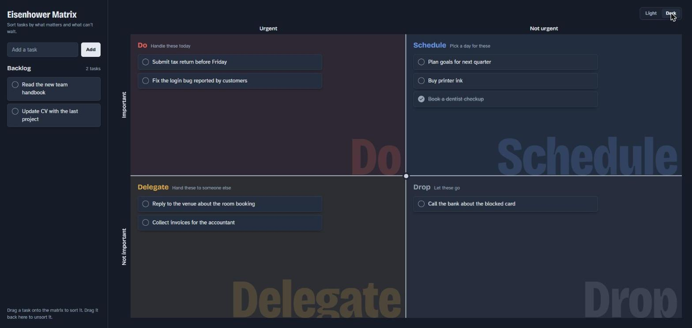

# Eisenhower Matrix

[](https://github.com/dbarretol/eisenhower-matrix/actions/workflows/ci.yml)

Sort your tasks by what matters and what can't wait. Add tasks to a backlog, then drag each one into the quadrant it belongs to: **Do**, **Schedule**, **Delegate** or **Drop**.



## Features

- **Four quadrants.** Urgent and important tasks go to Do, important ones to Schedule, urgent ones to Delegate, and the rest to Drop.
- **Drag and drop.** Move tasks between the backlog and the quadrants, and reorder them inside a list. Drag a task back to the backlog to unsort it.
- **Keyboard and touch.** Every move you can make with a mouse also works with the keyboard and with press-and-hold on touch screens.
- **Saved automatically.** Tasks stay in your browser between visits. Nothing is sent to a server.
- **Undo delete.** Deleted a task by mistake? Click **Undo** in the notification.
- **Light and dark themes.** Follows your system setting until you pick one.
- **Search.** A search field appears once the backlog has six or more tasks.

## Getting started

You need [Node.js](https://nodejs.org/) 22.12 or later.

```bash
git clone https://github.com/dbarretol/eisenhower-matrix.git
cd eisenhower-matrix
npm install
npm run dev
```

Then open the address Vite prints in your terminal.

| Command              | What it does                                   |
| -------------------- | ---------------------------------------------- |
| `npm run dev`        | Starts the development server                  |
| `npm run build`      | Type-checks and builds the app into `dist/`    |
| `npm run preview`    | Serves the production build locally            |
| `npm run lint`       | Runs ESLint                                    |
| `npm test`           | Runs the unit tests once                       |
| `npm run test:watch` | Runs the unit tests and reruns them on changes |

## Using the keyboard

1. Press <kbd>Tab</kbd> to focus a task.
2. Press <kbd>Space</kbd> or <kbd>Enter</kbd> to pick it up.
3. Use <kbd>↑</kbd> and <kbd>↓</kbd> to move it inside a list, and <kbd>←</kbd> and <kbd>→</kbd> to move it to the list on that side.
4. Press <kbd>Space</kbd> or <kbd>Enter</kbd> to drop it, or <kbd>Esc</kbd> to put it back where it was.

Screen readers announce each step.

## Your data

Tasks are stored in your browser's `localStorage`, so they belong to that browser and that device. Clearing your site data deletes them. If the saved data can't be read, the app starts empty and keeps a copy of the unreadable data under the `eisenhower-matrix-tasks-corrupted-backup` key.

## Built with

- [React](https://react.dev/) 19 and [TypeScript](https://www.typescriptlang.org/)
- [Vite](https://vite.dev/)
- [Tailwind CSS](https://tailwindcss.com/) 4
- [dnd kit](https://dndkit.com/) for drag and drop
- [Radix UI](https://www.radix-ui.com/) checkbox and [Sonner](https://sonner.emilkowal.ski/) notifications
- [Bricolage Grotesque](https://fonts.google.com/specimen/Bricolage+Grotesque) and [Atkinson Hyperlegible](https://www.brailleinstitute.org/freefont/) typefaces

## Project structure

```text
src/
├── App.tsx         Page layout, drag-and-drop context and delete with undo
├── components/     UI components (matrix, quadrants, task list, task card)
├── hooks/          Task storage, drag and drop, theme, reduced motion
├── lib/            Quadrant definitions, drag-and-drop behavior, helpers
└── types/          Shared types
```

## License

[MIT](LICENSE)
